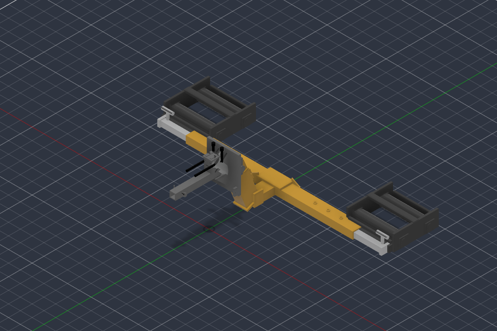
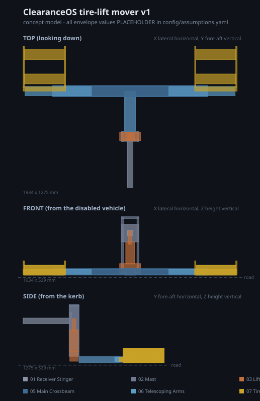

# CAD — ClearanceOS tire-lift mover v1

The rig TowFit is reasoning about. It mounts on a patrol car's rear hitch
receiver, reaches under a disabled vehicle, grips one axle's tires between
paired rollers, lifts them clear of the road, and lets the patrol car draw the
vehicle — in neutral — out of a live lane.

> **Concept model for the pitch. Not a design for fabrication.**
> Nothing here has been through a load case. Every envelope value it respects
> is still `PLACEHOLDER` in `config/assumptions.yaml`.



**163 parts across 10 components.** Overall 1 972 × 1 288 × 560 mm in the
lowered position.



## The mechanism

A **pivoting L-arm wheel lift**, which is how real tow rigs do this.

```
                      ram tower
                     (0, 20, 505)
                          ╷
                          │  hydraulic ram
                          │  355 mm closed, −49°
     receiver ════════╤═══╪══╗
                      │   ╵   ╲                 pivot (0, 190, 390)
                 mount plate    ╲
                                 ╲  lift arm
                                  ╲ 368 mm at −67.6°
                                   ╲
                                    ╲
          road ─ ─ ─ ─ ─ ─ ─ ─ ─ ─ ─ ─╳══════════════╦══ crossbeam
                                   knee (y 330)      ║   (y 560, z 50)
                                                 tire cradles
```

1. A **yoke** on the receiver carries the main pivot at `(0, 190, 390)`.
2. A **slanted arm** drops from that pivot down and forward to a knee at
   `y = 330`, 368 mm long, raked −67.6° when lowered.
3. A **horizontal boom** runs from the knee under the vehicle to the
   crossbeam at `y = 560`, sitting at `z = 50`.
4. A **hydraulic ram** between a tower on the stinger `(0, 20, 505)` and a lug
   45% along the arm `(0, 253, 237)` extends to rotate the whole assembly up
   about the pivot, lifting the gripped tires off the road.

The vehicle must be in neutral — that is the rule engine's central
precondition, and it is what makes a one-axle lift sufficient. The lifted
axle's tires come off the road; the other axle rolls.

> An earlier version of this model used a **vertical mast with a sliding
> carriage**. That was wrong: not how wheel lifts work, and it put a tall mast
> below hitch height where it would drag. It was replaced in `35c05c6`.

## Why the model is a script, not a checked-in part file

The rig envelope lives in `config/assumptions.yaml` because the rule engine
checks real vehicles against it — `R-DIM-TIRE-WIDTH`, `R-DIM-CLEARANCE` and
`R-DIM-WHEELBASE` in `services/api/app/engine/towfit.py` all read those keys.

If the CAD carried its own copy of those numbers, the two would drift the
first time the hardware team supplied a real one, and nobody would notice
until a `RED` verdict disagreed with a part that physically fits. So the
geometry is **derived from that file at build time**.

```
config/assumptions.yaml ──► cad/scripts/rig_spec.py ──┬──► build_tire_lift_rig.py  (Fusion 360)
                                                      ├──► export_stl.py           (.stl)
                                                      └──► export_views.py         (.svg)
```

`rig_spec.py` is the only place the geometry exists. If a consumer ever
disagrees with it, the consumer is wrong.

## Files

| Path | What |
|---|---|
| `scripts/rig_spec.py` | Geometry, envelope loading, bounds and checks. Pure Python, no dependencies. |
| `scripts/build_tire_lift_rig.py` | Fusion 360 script. Builds the parametric solid. |
| `scripts/export_stl.py` | Writes a binary STL. No Fusion, no packages. |
| `scripts/export_views.py` | Writes the three-view SVG above. |
| `exports/` | `.f3d`, `.step`, `.stl`. Build outputs — regenerate rather than hand-edit. |
| `reference/` | Generated drawings and render. |

## Rebuild

```bash
python cad/scripts/export_stl.py     # .stl + all nine checks
python cad/scripts/export_views.py   # .svg
```

Both print which file the envelope came from, and `export_stl.py` exits
non-zero if the geometry violates it.

In Fusion 360: **Utilities → ADD-INS → Scripts and Add-Ins**, run
`TowFitRig`. It builds the solid, writes the envelope into the parameter
table with each value's registry key, applies a material per component,
exports `.f3d` and `.step` into `exports/`, and reports the same checks.

It builds in **direct modelling mode**, not parametric. The parametric model
is `rig_spec.py` — nobody will hand-edit a 163-part generated timeline — and
keeping the history made Fusion crawl and eventually fall over on this
part count.

## Components

| | Component | Parts | What it carries |
|---|---|---:|---|
| 01 | Receiver Interface | 28 | 2 in stinger, hitch pin, mount plate, gussets, bolt bosses, chain eyes |
| 02 | Ram Tower | 10 | Post and lugs anchoring the ram above the stinger |
| 03 | Pivot Yoke | 9 | Yoke plates, pivot pin, weld-in bushings |
| 04 | Lift Arm | 13 | Slanted box tube, pivot boss, ram lug, knee plate |
| 05 | Lift Ram | 12 | Barrel, rod, clevises, eye bushing, ports and fittings |
| 06 | Lower Boom | 8 | Horizontal tube from knee to crossbeam, knee plates |
| 07 | Main Crossbeam | 15 | 100 × 60 box section, end caps, saddle, detent bushings |
| 08 | Telescoping Arms | 20 | Sliding tubes, end stops, pull handles, detents |
| 09 | Tire Cradles | 42 | Roller shafts, roller shells, bearing blocks and caps, side plates, tie bars, pads |
| 10 | Hydraulics | 6 | Hose runs and fittings |

## Where the numbers come from

**From the registry** (`unit.patrol_42.*`, all `PLACEHOLDER`):

| Envelope | Value | Drives |
|---|---|---|
| `rig_capacity_lb` | 6 000 lb | Nothing geometric yet — recorded in the parameter table |
| `rig_tire_width_range_mm` | 155–315 mm | Roller length = 315 + 45 = **360 mm** |
| `rig_min_ground_clearance_mm` | 90 mm | Beam height = 90 − 20 road gap − 10 safety = **60 mm** |
| `rig_max_wheelbase_mm` | 4 000 mm | Recorded; the rig grips one axle, so wheelbase bounds approach, not section |

**Not from the registry — concept estimates, unsourced and unanalysed:**
wall thickness (6 mm), beam section (100 × 60 mm), beam length (1 400 mm),
road gap (20 mm), roller diameter (90 mm), roller spacing (220 mm), hitch
height (400 mm), pivot and anchor positions, lift stroke (150 mm), assumed
axle track (1 550 mm), arm extension (250 mm per side).

The assumed track is the one worth arguing with: it is a guess at a typical
passenger-car axle, and both the arm extension and the cradle spacing are
sized from it rather than from anything measured.

## Checks

`export_stl.py` asserts the geometry against the envelope and fails loudly.
Six compare numbers; three measure where the parts actually ended up.

```
[PASS] beam fits under min ground clearance             80 mm beam top vs 90 mm clearance
[PASS] rollers span the widest gripped tire             360 mm roller vs 315 mm tire
[PASS] rollers still support the narrowest gripped tire 360 mm roller vs 155 mm tire
[PASS] beam spans a typical axle track                  1900 mm extended vs 1550 mm track
[PASS] arms clear the beam's internal section           44 mm arm height
[PASS] ram reaches its lug from the tower anchor        355 mm closed length
[PASS] nothing hangs below the road gap                 lowest part at 20 mm vs 20 mm gap
[PASS] rig stays within a sane overall width            1972 mm wide vs 2000 mm limit
[PASS] cradles reach past the axle to grip the tires    reach 978 mm vs beam at 560 mm
```

The last three exist because the first six could not catch what actually went
wrong during the rebuild: knee plates hanging to `z = 9`, detent bushings
protruding 3 mm under the crossbeam, and the frame quietly growing to
2 030 mm wide — wider than the car it is meant to move. Numeric checks compare
numbers to numbers; these measure the assembled result.

The width limit is **derived**, not absolute: `track + roller_len + 90`. A rig
that straddles a 1 550 mm track and grips a 315 mm tire cannot be narrower
than ~1 950 mm, so a fixed number would either fail on geometry the envelope
demands or pass anything. Only frame bloat on top of that is worth failing.

The first check is still the one that matters most.
`rig_min_ground_clearance_mm` is the promise that the rig can reach under a
vehicle, and the beam is the part that has to keep it. At 90 mm the beam is
60 mm with a 20 mm road gap, leaving 10 mm. **Lower that assumption and the
beam has to get thinner** — at roughly 40 mm of clearance the section stops
being buildable in steel, which is a hardware answer, not a CAD one.

## What this model does not do

- **No stress analysis.** 6 000 lb is a number in the parameter table, not a
  load case. Section sizes are drawn for proportion.
- **No joints or motion study.** Built in the lowered position. The 150 mm
  stroke is a dimension, not a constrained mechanism — the arm will not swing
  if you drag it.
- **No patrol car.** The receiver interface is modelled; the vehicle is not.
- **Overlapping solids at joints**, not welds or fasteners.
- **No boolean holes.** Pin locations are shown as weld-in bushings, which are
  real parts, rather than cuts — so the STL and the Fusion model stay
  identical.

## Open questions for the hardware team

1. Real `rig_capacity_lb`, and is the limit the rig or the patrol car?
2. Real tire-width grip range — 155–315 mm is invented.
3. Real minimum ground clearance. This one sets the beam section.
4. Axle track range to size arm extension and cradle spacing against.
5. Is a hitch receiver the actual mount, or is it chassis-mounted?
6. Ram bore, stroke and working pressure — the current ram is a shape.

Answers belong in `config/assumptions.yaml` with status moved off
`PLACEHOLDER`. Re-running the scripts then updates the model.

## Notes for anyone running the Fusion script

- It **reloads `rig_spec` on every run**. Fusion keeps one Python interpreter
  alive per session, so without that an edited spec stays cached and the
  script silently rebuilds the previous geometry.
- It **builds into the active document only when that document is an unsaved,
  unnamed, geometry-free one**, otherwise it opens a new one. An earlier
  version called `documents.add()` before anything could fail, so every error
  stranded an empty tab — and because the script switches the design to direct
  modelling, which discards a timeline, it must never do that to a real file
  that merely happens to be empty at that moment.
- The script **cannot name the document**. Fusion derives the root component's
  name from the document, and a document has no name until it is saved, so
  `root.name = ...` raises `root component name cannot be changed` and is
  caught. Save the document as **`ClearanceOS Tire-Lift Mover v1`** and the
  root component picks the name up by itself. The committed `.f3d` was
  exported after that save, so it already carries it.
